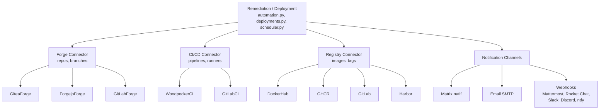

# Connecteurs

Architecture de connecteurs universels avec interfaces abstraites et factories.
Utilisés par le layer Remediation / Deploiement (`automation.py`, `deployments.py`, `scheduler.py`).



## Configuration des tokens

### Gitea / Forgejo

1. Aller dans **Settings > Applications > Manage Access Tokens**
2. Creer un token avec les scopes :

| Scope | Permission | Usage |
|-------|------------|-------|
| **repository** | **Lecture** | Lister repos, branches, contenu fichiers |

Aucun autre scope necessaire. Le token est read-only.

3. Copier le token dans le CMDB : **Settings > CI/CD > Gitea Token** ou `GITEA_TOKEN` dans `.env`

### Woodpecker

1. Aller sur l'interface Woodpecker (`ci.example.com`)
2. Cliquer sur l'avatar > **Settings**
3. Section **Personal API tokens** > generer un token

Ou via CLI si acces au serveur :
```bash
woodpecker-cli token
```

Le token personnel a acces a tout ce que l'utilisateur peut faire (pas de scopes granulaires). Pour limiter les droits, creer un utilisateur dedie (ex: `cmdb-bot`) avec acces uniquement aux repos necessaires.

4. Copier le token dans le CMDB : **Settings > CI/CD > Woodpecker Token** ou `WOODPECKER_TOKEN` dans `.env`

### GitLab

1. Aller dans **Settings > Access Tokens** (projet ou groupe)
2. Creer un token avec les scopes :

| Scope | Usage |
|-------|-------|
| `read_api` | Lister projets, pipelines, runners |
| `read_repository` | Branches, fichiers CI |

Pour declencher des pipelines (scheduler, deployments), ajouter `api` (lecture+ecriture).

3. Copier le token dans le CMDB via l'UI **Pipelines > Servers > Add Server**

### Matrice d'acces par connecteur

| Connecteur | Lecture repos | Branches | Detection CI | Sync pipelines | Trigger pipeline |
|------------|:---:|:---:|:---:|:---:|:---:|
| Gitea (repository:read) | x | x | x | — | — |
| Woodpecker (token personnel) | x | — | — | x | x |
| GitLab (read_api) | x | x | x | x | — |
| GitLab (api) | x | x | x | x | x |

> **Note** : Gitea fournit les repos et branches, Woodpecker fournit les pipelines et agents. Les deux tokens sont complementaires.

## Connecteurs Forge

Interface abstraite `ForgeConnector` avec methodes : `test_connection()`, `list_repos()`, `get_branches()`, `has_ci_config()`.

| Connecteur | API | Auth | Detection CI |
|------------|-----|------|--------------|
| `GiteaForge` | Gitea v1 | header `token` | `.woodpecker/` |
| `ForgejoForge` | Gitea v1 (compatible) | header `token` | `.woodpecker/`, `.forgejo/workflows/` |
| `GitLabForge` | GitLab v4 | header `PRIVATE-TOKEN` | `.gitlab-ci.yml` |

### Ajouter un serveur forge

Dans l'UI : **Pipelines > Servers > Add Server**, ou via API :

```bash
curl -X POST /api/v1/cicd/servers \
  -H "Authorization: Bearer $TOKEN" \
  -d '{"name": "my-gitlab", "server_type": "gitlab", "url": "https://gitlab.example.com", "token": "glpat-xxx"}'
```

## Connecteurs CI/CD

Interface abstraite `CIConnector` avec methodes : `test_connection()`, `list_pipelines()`, `list_runners()`, `trigger_pipeline()`.

| Connecteur | API | Auth | Type runner |
|------------|-----|------|-------------|
| `WoodpeckerCI` | Woodpecker REST | Bearer token | Agents |
| `GitLabCI` | GitLab v4 | `PRIVATE-TOKEN` | Runners |

### Sync workers

```bash
# Sync depuis Woodpecker (defaut)
curl -X POST /api/v1/cicd/workers/sync

# Sync depuis GitLab
curl -X POST /api/v1/cicd/workers/sync?ci_system=gitlab
```

### Declencher un pipeline

```bash
curl -X POST /api/v1/cicd/pipelines/trigger \
  -d '{"ci_system": "woodpecker", "repo_name": "youruser/cmdb", "branch": "main"}'

curl -X POST /api/v1/cicd/pipelines/trigger \
  -d '{"ci_system": "gitlab", "repo_name": "group/project", "branch": "main"}'
```

## Connecteurs Registry

Interface abstraite `RegistryConnector` avec methodes : `resolve_latest()`, `list_tags()`.

| Connecteur | Registry | Auth |
|------------|----------|------|
| `DockerHubRegistry` | Docker Hub | Anonyme |
| `GHCRRegistry` | GitHub Container Registry | Token anonyme |
| `GitLabRegistry` | GitLab Container Registry | Bearer token |
| `HarborRegistry` | Harbor v2 | Basic auth |

Utilise par la vue **Repositories** pour verifier les mises a jour disponibles.

## Webhooks de notification

Webhooks generiques stockes dans la table `notification_webhooks`. Chaque webhook a :
- **Plateforme** : `mattermost`, `rocketchat`, `slack`, `discord`, `ntfy`, `gotify`, `generic`
- **Filtres de routage** : activer/desactiver par categorie (CVE, securite, CI/CD, backup)
- **Override canal** : canal/room par categorie

### Configuration dans l'UI

**Settings > Notification Webhooks > Add Webhook**

### Format payload par plateforme

| Plateforme | Payload |
|------------|---------|
| Mattermost, Rocket.Chat, Slack, generic | `{"text": "message", "channel": "#room"}` |
| Discord | `{"content": "message"}` |
| ntfy | `{"topic": "channel", "message": "message"}` |

### Scripts de sync

| Script | Source | Donnees |
|--------|--------|---------|
| `tools/sync_woodpecker.py` | Gitea + Woodpecker | Repos, pipelines, agents |
| `tools/sync_gitlab.py` | GitLab | Projets, pipelines, runners |
| `tools/sync_forgejo.py` | Forgejo | Repos (pas de CI) |

Chaque script tourne dans un container Docker avec des variables d'environnement et push vers l'API CMDB.
